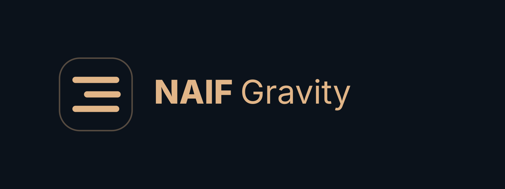

# NAIF Gravity

Free developer tools and reproducible diagnostics for **Model Context Protocol (MCP), APIs, authentication and webhooks**.

## Featured NAIF Gravity products

| Product | First value | Explore |
| --- | --- | --- |
| **[MCP Doctor](https://github.com/naief9961-tech/naif-gravity-mcp-diagnostics)** — free, MIT | MCP Streamable HTTP discovery diagnostics and local Error Passport evidence | [Install from PyPI/npm](https://github.com/naief9961-tech/naif-gravity-mcp-diagnostics#install-from-pypi-or-npm) |
| **[NAIF JSON Rescue](https://github.com/naief9961-tech/ai-growth-engine/tree/main/skills/naif-json-rescue)** — free Skill | Local JSON syntax checks without uploading the sample | [Skill instructions](https://github.com/naief9961-tech/ai-growth-engine/blob/main/skills/naif-json-rescue/SKILL.md) |
| **[Free JSON/API/CSV previews](https://naifgravity.com/micro-v2)** | Try a bounded sample without a charge | [Run a preview](https://naifgravity.com/micro-v2) |
| **[NAIF Patch Evidence](https://naifgravity.com/service/naif-patch-evidence?utm_source=github&utm_medium=profile&utm_campaign=patch_evidence_launch)** — Founders v0.12, $9 one-time | Offline owner-signed Git handoff review plus an optional ED25519 Signed Evidence Receipt: reviewers sign a complete PASS audit and its JSON/HTML/Markdown report hashes; recipients verify those report bytes without receiving source. Full source SHA-256 and Git HEAD/index checks retained, with Mac/Linux + Python support. No trusted timestamp, source re-audit from receipt, or universal Git/Sigstore superiority claim. | [Explore · العربية / English](https://naifgravity.com/service/naif-patch-evidence?utm_source=github&utm_medium=profile&utm_campaign=patch_evidence_launch) |
| **[Focused technical services](https://naifgravity.com/services?utm_source=github&utm_medium=profile&utm_campaign=product_discovery)** — optional | Separately scoped JSON, API, webhook, Docker and repair checks | [Browse live products](https://naifgravity.com/services?utm_source=github&utm_medium=profile&utm_campaign=product_discovery) |

**[View all products and choose by problem →](https://github.com/naief9961-tech/ai-growth-engine/blob/main/PRODUCTS.md)** · [Free troubleshooting guides](https://naifgravity.com/discover) · [الأدلة بالعربية](https://naifgravity.com/ar/discover)

**Free-first policy:** preview and local checks are not paid repairs. Micro V2 preview pages do not currently offer a separate paid V2 report checkout. Live service pages define their own scope and price.

## Start with MCP Doctor

**[NAIF Gravity MCP Doctor](https://github.com/naief9961-tech/naif-gravity-mcp-diagnostics)** checks MCP Streamable HTTP discovery and turns sanitized reports into local Error Passports with evidence and free next steps.

- **[Install from PyPI](https://pypi.org/project/naif-gravity-mcp-doctor/)** or **[npm](https://www.npmjs.com/package/naif-gravity-mcp-doctor)**. Both use the same Python implementation; npm also requires Python 3.10+.
- **[Try the free local demo](https://github.com/naief9961-tech/naif-gravity-mcp-diagnostics#see-a-healthy-and-a-broken-mcp-response):** from a complete checkout, run `python3 examples/mcp_discovery_demo.py`. Synthetic loopback fixtures show healthy discovery passing and an HTTP 200 response with the wrong JSON-RPC ID failing. No account, credentials or external requests.
- Offline report mode stays local. Optional probing contacts only an authorized endpoint and checks `initialize` / `tools/list`; it does not execute server tools or repair a service.

**بالعربية:** أداة مجانية لتشخيص اتصال MCP وإعداد تقرير محلي بالأدلة. [جرّب الأداة](https://github.com/naief9961-tech/naif-gravity-mcp-diagnostics) أو اقرأ [أدلة التشخيص العربية](https://naifgravity.com/ar/discover).

### More ways to use MCP Doctor

- [Local fault lab](https://github.com/naief9961-tech/naif-gravity-mcp-diagnostics#fault-lab-and-issue-drafts): reproduce discovery failures with synthetic fixtures.
- [Offline GitHub Action](https://github.com/naief9961-tech/naif-gravity-mcp-diagnostics/blob/main/docs/ERROR-PASSPORT.md): turn sanitized reports into CI evidence without automatic remote probing.
- [Before/after comparison](https://github.com/naief9961-tech/naif-gravity-mcp-diagnostics#compare-discovery-before-and-after-an-update): compare bounded discovery reports after an integration change.

## A documented diagnostic contribution

In Apache SkyWalking BanyanDB, [our manual review and isolated reproduction](https://github.com/apache/skywalking-banyandb/pull/1460#issuecomment-6623639937) identified configuration values being read before `.env` was loaded. **wanjinhao1**, the PR author, [corrected the loading order and added regression tests](https://github.com/apache/skywalking-banyandb/pull/1460#issuecomment-6623863250). [PR #1460](https://github.com/apache/skywalking-banyandb/pull/1460) was merged on 9 November 2026.

This was manual diagnosis, not automatic detection by MCP Doctor. Credit for implementing the fix belongs to the PR author. The contribution does not imply Apache endorsement or a production authentication test.

## More free diagnostics

The **[NAIF Gravity Diagnostic Hub](https://github.com/naief9961-tech/ai-growth-engine/blob/main/NAIF-GRAVITY.md)** contains troubleshooting guides, reproducible examples and structured issue templates for MCP, API/Auth and webhook failures.

Our approach: collect reproducible evidence, identify the smallest repair, verify the result, and avoid unnecessary rebuilds.

## For AI agents

Read-only discovery starts at the production domain:

- [Agent Card](https://naifgravity.com/.well-known/agent-card.json): identity, skills and advertised interfaces.
- [Remote MCP endpoint](https://naifgravity.com/mcp): Streamable HTTP; use an MCP client rather than a normal browser GET.
- [Agent service catalog](https://naifgravity.com/api/agent/catalog): current descriptions, eligibility and purchase instructions.
- [x402 resource manifest](https://naifgravity.com/.well-known/x402) and [OpenAPI](https://naifgravity.com/openapi.json): advertised API and payment metadata.

Discovery metadata does not prove successful payment or authorize a production repair.

## Optional professional services

Visit **[NAIF Gravity](https://naifgravity.com/?utm_source=github&utm_medium=profile&utm_campaign=github_funnel)** for separately scoped MCP, API/Auth and webhook troubleshooting. See the [live service catalog](https://naifgravity.com/services?utm_source=github&utm_medium=profile&utm_campaign=one_time_services) for current prices, availability and regional eligibility. Free tools remain usable without a purchase; any paid work requires explicit agreement.

## Current engineering work

- AI-agent and MCP interoperability.
- API/Auth/Webhook troubleshooting.
- Reproducible diagnostics and validation.
- Public technical contributions, issue triage and integration testing.

## Security

Do **not** publish API keys, bearer tokens, cookies, private keys, seed phrases, payment credentials or customer data in GitHub issues.

Use only endpoints and systems you own or are authorized to test.
